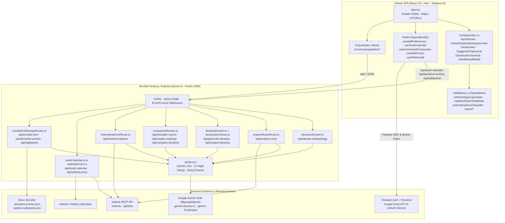
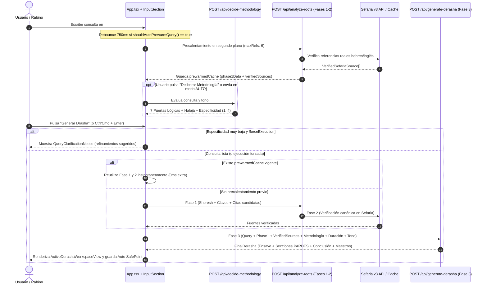
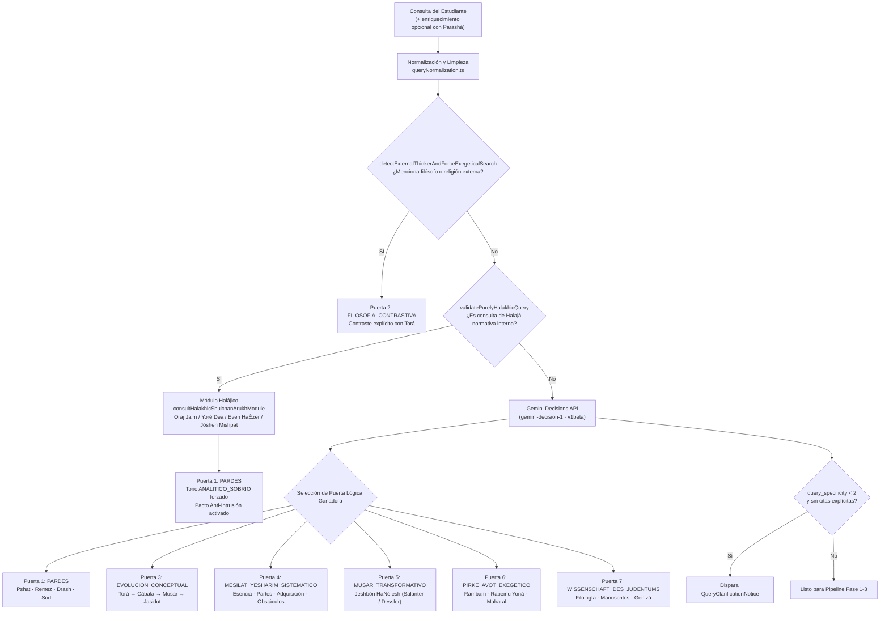
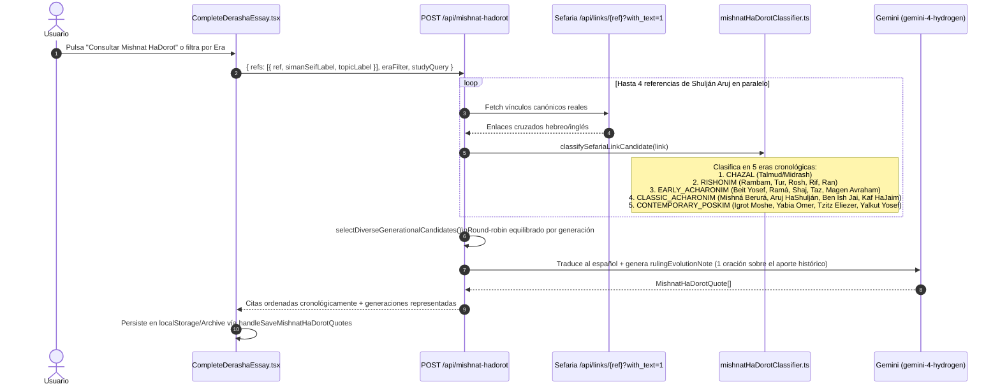
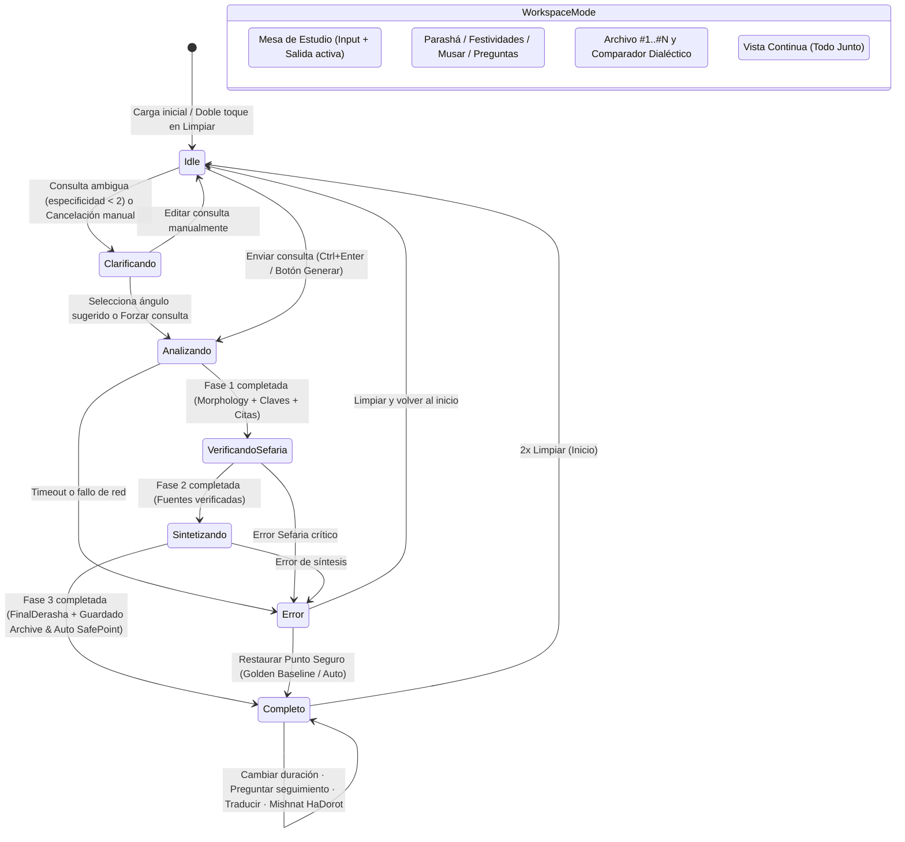
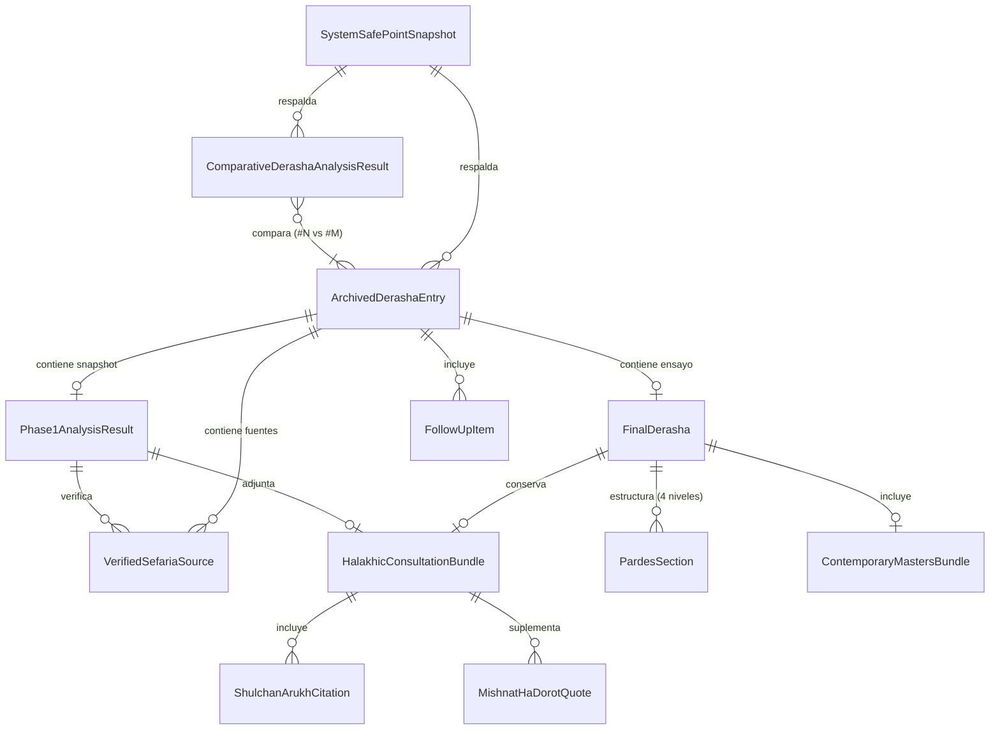

# Manual de Arquitectura e Ingeniería — Darshán AI (Material de Apoyo para GitHub)

Documento técnico de referencia para desarrolladores, arquitectos y colaboradores de **Darshán AI**: asistente rabínico y pedagógico de estudios judaicos y *Derashot* basado en un **pipeline antialucinación de 3 fases**, verificación canónica contra la **API de Sefaria**, deliberación de **7 Puertas Lógicas Hermenéuticas**, **Módulo Halájico** (*Shulján Aruj* + cadena generacional *Mishnat HaDorot*), almacenamiento híbrido (**Local / Servidor Express / Firebase Firestore / Google Drive personal**) y empaquetado **PWA + Capacitor Android**.

---

## Tabla de Contenidos

1. [Visión General del Sistema y Stack Tecnológico](#1-visión-general-del-sistema-y-stack-tecnológico)
2. [Diagrama de Arquitectura General](#2-diagrama-de-arquitectura-general)
3. [Estructura de Archivos e Inventario de Módulos](#3-estructura-de-archivos-e-inventario-de-módulos)
4. [Flujo del Pipeline Antialucinación en 3 Fases y Precalentamiento](#4-flujo-del-pipeline-antialucinación-en-3-fases-y-precalentamiento)
5. [Sistema de 7 Puertas Lógicas Hermenéuticas y Módulo Halájico](#5-sistema-de-7-puertas-lógicas-hermenéuticas-y-módulo-halájico)
6. [Arquitectura de *Mishnat HaDorot* (Dictamen por Generación)](#6-arquitectura-de-mishnat-hadorot-dictamen-por-generación)
7. [Máquina de Estados de la Interfaz y Flujos de Usuario](#7-máquina-de-estados-de-la-interfaz-y-flujos-de-usuario)
8. [Modelos de Datos y Diagrama Entidad-Relación](#8-modelos-de-datos-y-diagrama-entidad-relación)
9. [Contratos de API REST (Backend Express)](#9-contratos-de-api-rest-backend-express)
10. [Cachés, Concurrencia, Timeouts y Resiliencia (SafePoints)](#10-cachés-concurrencia-timeouts-y-resiliencia-safepoints)
11. [Seguridad, Reglas de Firestore y Google Drive OAuth](#11-seguridad-reglas-de-firestore-y-google-drive-oauth)
12. [Instalación, Variables de Entorno, Compilación PWA y Android](#12-instalación-variables-de-entorno-compilación-pwa-y-android)

---

## 1. Visión General del Sistema y Stack Tecnológico

| Capa | Tecnología / Versión | Propósito |
| :--- | :--- | :--- |
| **Frontend UI** | React 19 (`^19.3.1`), TypeScript (`7.0.2`), Tailwind CSS v4 (`@tailwindcss/vite`) | SPA editorial en modo oscuro, lectura de atril (`A`/`A+`/`A++`), RTL hebreo, vistas PARDÉS y ensayo continuo. |
| **Iconografía** | `lucide-react` (`0.546.0`) | Iconos vectoriales ligeros sin librerías pesadas adicionales. |
| **Bundler Dev/Prod** | Vite (`8.3.5`) + `esbuild` (`0.28.2`) + `tsx` (`4.23.15`) | En desarrollo, Vite corre como `middlewareMode` sobre Express; en producción, compila SPA en `dist/` y servidor en `dist/server.js`. |
| **Backend HTTP** | Node.js + Express (`4.22.3`) en puerto `3000` | Orquestador de IA, proxy Sefaria, calendario hebreo, almacenamiento local en JSON y protección de claves en servidor. |
| **Motor de IA** | `@google/genai` (`^3.3.0`) | `gemini-decision-1` (Decisions API calibrada v1beta) y `gemini-4-hydrogen` (análisis morfológico, traducción, síntesis y comparativa). |
| **Fuentes Canónicas** | Sefaria API (`v3/texts`, `api/links`) + Hebcal + Biblioteca Pre-Sembrada | Validación textual en hebreo, arameo e inglés antes de redactar la Drashá final. |
| **Persistencia Cloud** | Firebase (`13.2.0` Auth + Firestore) + Google Drive API v3 (`drive.file`) | OAuth client-side en Google, archivo privado en Google Drive (`0 KB` locales opcional) y reglas estrictas en Firestore. |
| **Exportación Documental** | Generadores nativos HTML-PDF (`window.print`), `.doc`, `.rtf`, `.md` | Exportación con alcance selectivo (`full_derasha`, `summary`, `pardes_cards`, `sources`). |
| **Móvil & Offline** | PWA (`public/sw.js`, `manifest`) + Capacitor Android (`com.darshanai.pardes`) | Instalable en escritorio/móvil y empaquetable como APK Android. |

---

## 2. Diagrama de Arquitectura General



---

## 3. Estructura de Archivos e Inventario de Módulos

### 3.1 Raíz del Proyecto

```text
/
├── server.ts                     # Entrada Express: rutas API, robots/sitemap, SafePoint guards, Vite middleware (dev) o dist/ (prod)
├── package.json                  # Scripts dev/build/start/lint y dependencias
├── vite.config.ts                # Configuración Vite + Tailwind v4 + chunks manuales
├── capacitor.config.json         # Empaquetado nativo Android (appId: com.darshanai.pardes, webDir: dist)
├── firebase-applet-config.json   # Configuración Firebase del proyecto activo
├── firebase-blueprint.json       # Esquema declarativo para Firestore
├── firestore.rules               # Reglas de seguridad Firestore (RBAC por ownerId y validación de campos)
├── MANUAL_USUARIO.md             # Manual de usuario final (sincronizado con UserManualModal.tsx)
├── MANUAL_PROGRAMADORES.md       # Este manual de arquitectura y diagramas para GitHub
└── README.md                     # Portada del repositorio con enlaces rápidos a ambos manuales
```

### 3.2 Backend (`/server`)

| Archivo | Responsabilidad Principal | Dependencias Clave |
| :--- | :--- | :--- |
| `server/aiClient.ts` | Inicialización de clientes `@google/genai` (`v1` y `v1beta`), resolución segura de `GEMINI_API_KEY`, mapas LRU acotados, deduplicación `inFlight*`, `generateContentWithRetry`, `parseGeminiJsonSafely`, clasificación HTTP. | `@google/genai`, `fs` |
| `server/decisionsRouter.ts` | Evalúa consultas mediante `gemini-decision-1` (metodología primaria, tono, halajá pura, contraste externo, puntaje de especificidad 1–4) + calibración determinista y respaldo local. | `aiClient.ts`, `methodologyLogicGates`, `toneAdvisor`, `halakhicShulchanArukhModule` |
| `server/analyzeRootsRoute.ts` | **Fase 1 y 2**: Extrae morfología (`shoresh`), claves teológicas, referencias canónicas e invoca verificación en Sefaria + módulo halájico. | `aiClient.ts`, `sefariaService.ts`, `externalSources.ts` |
| `server/derashaRoutes.ts` | **Fase 3**: Orquesta generación integral de la *Derashá* (`5_MIN` / `10_MIN` / `30_MIN`) y seguimiento exegético (`/api/expand-derasha`). | `derashaSynthesis.ts`, `methodologyPrompts.ts`, `aiClient.ts` |
| `server/derashaSynthesis.ts` | Constructores de prompts por metodología, cálculo de presupuesto de palabras según duración y normalización/sanitización de salida JSON. | `externalSources.ts`, `methodologyPrompts.ts` |
| `server/companionRoutes.ts` | Traducción individual y en lote (`/api/translate-source`), lecturas de maestros contemporáneos (`/api/master-readings`) y análisis dialéctico comparativo (`/api/compare-derashot`). | `aiClient.ts`, `externalSources.ts` |
| `server/mishnatHaDorotRoute.ts` | Consulta `/api/links/{ref}` en Sefaria para citas del *Shulján Aruj*, clasifica autoridades por 5 eras históricas y genera traducción + nota de evolución normativa. | `mishnatHaDorotClassifier.ts`, `sefariaService.ts`, `aiClient.ts` |
| `server/sefariaService.ts` | Proxy normalizado a Sefaria `v3/texts`, diccionario `PRE_SEEDED_CANONICAL_SOURCES` (respaldo offline/alta velocidad) y limpieza de HTML. | `aiClient.ts` |
| `server/torahCalendar.ts` | Calendario hebreo semanal (`Parashat HaShavua`, `Aliyot`, `Haftará`, festividades próximas y modo diáspora/Israel). | `aiClient.ts`, Sefaria Calendars |
| `server/mesilatAndStorageRoutes.ts` | Generación de *Shots* diarios de *Mesilat Yesharim* (`/api/mesilat-shot`) y persistencia en disco (`.derashot-archive.json` y `.system-safepoints.json`). | `aiClient.ts`, `sefariaService.ts`, `fs` |
| `server/methodologyPrompts.ts` | Reglas de diseño por cada una de las 7 metodologías y breves complementarios para síntesis multi-metodológica. | — |
| `server/externalSources.ts` | Pacto estricto de fuentes judías (`STRICT_JEWISH_SOURCES_COVENANT`) y sanitizador recursivo anti-intrusión en temas internos. | — |
| `server/queryNormalization.ts` | Normalización de consulta, limpieza de caracteres y detección de prefijos/comandos especiales. | — |

### 3.3 Frontend (`/src`)

| Carpeta | Módulos | Función |
| :--- | :--- | :--- |
| `src/hooks/` | `useAtrilPreferences`, `useTorahCalendar`, `useArchiveAndComparator`, `useSafePoints`, `usePWAInstall`, `index.ts` | Encapsulación de preferencias tipográficas, calendario semanal, archivo #1–#N + Google Drive/Firestore, respaldos Golden Baseline y registro PWA. |
| `src/services/` | `api.ts`, `sefaria.ts`, `archiveService.ts`, `safePointService.ts`, `firebase.ts`, `googleDriveStorageService.ts`, `index.ts` | Clientes `fetch` hacia Express, acceso a Firebase Auth/Firestore y CRUD OAuth hacia carpeta `Darshán AI · Mis Derashot` en Google Drive. |
| `src/services/pipeline/` | `executePhase1And2Pipeline.ts`, `executePhase3DerashaSynthesis.ts`, `executeFullDerashaPipeline.ts`, `queryEnrichment.ts`, `types.ts` | Ejecución coordinada de fases, reutilización de caché precalentado, resíntesis por cambio de duración y enriquecimiento con Parashá actual. |
| `src/utils/` | `methodologyCatalog.ts`, `methodologyLogicGates.ts`, `halakhicShulchanArukhModule.ts`, `halakhicPipelineValidator.ts`, `mishnatHaDorotClassifier.ts`, `externalThinkerDetector.ts`, `toneAdvisor.ts`, `topicEssence.ts`, `derashaSummary.ts`, `documentExport.ts` | Motor de clasificación de 7 Puertas Lógicas, validación halájica, clasificador de 5 eras para Sefaria Links y utilidades de resumen. |
| `src/utils/export/` | `shared.ts`, `pdfExport.ts`, `htmlWordExport.ts`, `rtfExport.ts`, `markdownExport.ts` | Exportadores independientes con alcance granular (`full_derasha`, `summary`, `pardes_cards`, `sources`). |
| `src/components/layout/` | `Header`, `WorkspaceNavigationBar`, `AboutModal`, `UserManualModal`, `ExportModal`, `SettingsModal`, `PWAInstallButton`, `OfflineIndicator`, `SystemSafePointBoundary` | Navegación superior, modal de ayuda manual, guía Pardés, configuración de atril/respaldos y manejo de errores React. |
| `src/components/pipeline/` | `InputSection`, `PhaseProgressIndicator`, `QueryClarificationNotice`, `ActiveDerashaWorkspaceView`, `CompleteDerashaEssay`, `PardesView`, `MorphologyCard`, `TheologicalKeysCard`, `CanonicalSourcesCard`, `ContemporaryMastersCard`, `PracticalConclusionCard`, `DerashaSummaryCard`, `ExegesisFollowUp` | Flujo completo de entrada, deliberación en tiempo real, progreso de 3 fases, lectura continua, fichas PARDÉS, módulo *Mishnat HaDorot* y profundización. |
| `src/components/discovery/` | `SuggestedTopicsHub`, `MesilatYesharimShotsCard` | Explorador semanal de Parashá/Aliyot, festividades, preguntas clásicas y *Musar Diario* del Ramjal. |
| `src/components/archive/` | `DerashotArchiveHub`, `SplitScreenComparator`, `ComparativeStudyResultView` | Archivo numerado persistente (`#1..#N`) y comparador dialéctico entre 2 o más *Derashot*. |

---

## 4. Flujo del Pipeline Antialucinación en 3 Fases y Precalentamiento

Para impedir citas inventadas o referencias truncadas, la aplicación **nunca** pide el ensayo completo en una sola llamada ciega. En su lugar ejecuta un precalentamiento automático (debounce de `750 ms` mientras el usuario escribe consultas válidas) y un pipeline en 3 fases verificables:



### Reglas del Orquestador Cliente (`src/services/pipeline/`)
- **Control de carreras (`activeRunIdRef` + `AbortController`)**: Cada nueva generación o `handleReturnToHome` incrementa `activeRunIdRef.current`, invalidando automáticamente cualquier respuesta tardía de ejecuciones canceladas.
- **Presupuestos de tiempo por duración**:
  - `5_MIN`: ~`130s` totales.
  - `10_MIN`: ~`155s` totales.
  - `30_MIN`: ~`180s` totales (`server.ts` fija `requestTimeout = 180000ms` y `headersTimeout = 185000ms`).
- **Auto-traducción en segundo plano**: Si Sefaria devuelve el texto en hebreo/inglés sin traducción española, las tarjetas de fuentes permiten traducción individual o por lotes vía `/api/translate-source`.

---

## 5. Sistema de 7 Puertas Lógicas Hermenéuticas y Módulo Halájico

El enrutador `decisionsRouter.ts` y `methodologyLogicGates.ts` arbitran entre 7 marcos hermenéuticos antes de iniciar la síntesis final:



---

## 6. Arquitectura de *Mishnat HaDorot* (Dictamen por Generación)

Cuando una consulta activa el **Módulo Halájico** (citas reales de *Shulján Aruj*), `CompleteDerashaEssay.tsx` ofrece el panel interactivo **Mishnat HaDorot** (`POST /api/mishnat-hadorot`) para trazar cómo evolucionó la halajá desde el Talmud hasta los *Poskim* contemporáneos sin alucinar citas:



---

## 7. Máquina de Estados de la Interfaz y Flujos de Usuario

### 7.1 Estados del Workspace y del Pipeline (`App.tsx`)



### 7.2 Modos de Lectura y Navegación Rápida
- **Atajos de teclado globales (`App.tsx`)**:
  - `?` o `F1` (fuera de campos editables): abre `UserManualModal`.
  - `Escape`: cierra cualquier modal activo (`UserManualModal`, `AboutModal`, `ExportModal`, `SettingsModal`).
  - `Ctrl/Cmd + Enter` dentro de `#query-input`: envía la consulta (o ejecuta comparación si detecta el patrón `#1 vs #2`).
- **Doble toque de rescate (`handleClearOrDoubleTapHome`)**:
  - 1er toque en **Limpiar**: vacía la caja de texto y arma una ventana de `2200 ms` (`2º toque: Inicio`).
  - 2º toque en `< 2.2s`: aborta peticiones en curso, limpia resultados activos y regresa a la vista limpia de inicio.

---

## 8. Modelos de Datos y Diagrama Entidad-Relación

Definiciones principales en `src/types.ts` y `firebase-blueprint.json`:



### Estructuras clave (`src/types.ts`)
- **`PipelineStage`**: `'idle' | 'analyzing' | 'fetching_sefaria' | 'synthesizing' | 'complete' | 'error'`
- **`DerashaMethodology`**: `'AUTO' | 'PARDES' | 'FILOSOFIA_CONTRASTIVA' | 'EVOLUCION_CONCEPTUAL' | 'MESILAT_YESHARIM_SISTEMATICO' | 'MUSAR_TRANSFORMATIVO' | 'PIRKE_AVOT_EXEGETICO' | 'WISSENSCHAFT_DES_JUDENTUMS'`
- **`DerashaDuration`**: `'5_MIN' | '10_MIN' | '30_MIN'`
- **`HalakhicGenerationEra`**: `'CHAZAL' | 'RISHONIM' | 'EARLY_ACHARONIM' | 'CLASSIC_ACHARONIM' | 'CONTEMPORARY_POSKIM'`

---

## 9. Contratos de API REST (Backend Express)

Todos los endpoints bajo `/api/*` tienen CORS habilitado y el guardia final devuelve JSON `404` ante rutas inexistentes (nunca HTML).

| Método | Ruta | Módulo | Entrada principal (JSON / Query) | Salida principal |
| :--- | :--- | :--- | :--- | :--- |
| `GET` | `/api/health` | `server.ts` | — | `{ status: "ok", timestamp }` |
| `POST` | `/api/decide-methodology` | `decisionsRouter.ts` | `{ query, tone? }` | `{ methodology, recommendedPrimary, recommendedTone, specificityScore, halakhicValidation, halakhicConsultation, ... }` |
| `POST` | `/api/analyze-roots` | `analyzeRootsRoute.ts` | `{ query, metodologia, duracion, audienciaOTono, tone?, maxRefs? }` | `{ phase1Data, verifiedSources, halakhicConsultation? }` |
| `POST` | `/api/generate-derasha` | `derashaRoutes.ts` | `{ query, phase1Data, verifiedSources, metodologia, complementaryMethodologies?, duracion, audienciaOTono }` | `{ finalDerasha }` |
| `POST` | `/api/expand-derasha` | `derashaRoutes.ts` | `{ query, followUpQuestion, finalDerasha, verifiedSources }` | `{ followUpAnswer, additionalSources? }` |
| `POST` | `/api/translate-source` | `companionRoutes.ts` | `{ ref, hebrewText, englishText }` o `{ sources: [...] }` | `{ spanishTranslation, notes? }` o `{ translations: [...] }` |
| `POST` | `/api/master-readings` | `companionRoutes.ts` | `{ query, title?, primaryHebrew?, verifiedSources, focusMaster, specificAngle? }` | `{ detectedParashaOrTopic, overview, readings }` |
| `POST` | `/api/compare-derashot` | `companionRoutes.ts` | `{ entries, relationType, userHypothesis }` | `ComparativeDerashaAnalysisResult` |
| `POST` | `/api/mishnat-hadorot` | `mishnatHaDorotRoute.ts` | `{ refs: [{ ref, simanSeifLabel?, topicLabel? }], eraFilter?, maxTotal?, studyQuery? }` | `{ quotes, generationsRepresented, sourceRefsConsulted, fetchedFromSefariaCount }` |
| `GET` | `/api/torah-calendar` | `torahCalendar.ts` | `?diaspora=1&timezone=...` | `{ parasha, haftara, aliyot, upcomingEvents, hebrewDate }` |
| `GET` | `/api/sefaria-proxy` | `sefariaService.ts` | `?ref=Genesis+1:1` | `{ ref, hebrewText, englishText, url }` |
| `POST` | `/api/mesilat-shot` | `mesilatAndStorageRoutes.ts` | `{ step?, chapter?, customAngle? }` | `{ middah, textHe, textEs, obstacle, actionToday, insight }` |
| `GET` | `/api/derashot-archive` | `mesilatAndStorageRoutes.ts` | — | `{ entries: ArchivedDerashaEntry[] }` |
| `POST` | `/api/derashot-archive` | `mesilatAndStorageRoutes.ts` | `{ entries }` | `{ status: "ok", count }` |
| `DELETE` | `/api/derashot-archive/:seq` | `mesilatAndStorageRoutes.ts` | `:seq` (número secuencial) | `{ status: "ok", entries }` |
| `GET` | `/api/safepoints` | `mesilatAndStorageRoutes.ts` | — | `{ status, serverArchiveCount, preSeededSourcesCount, snapshots }` |
| `POST` | `/api/safepoints` | `mesilatAndStorageRoutes.ts` | `{ snapshot }` | `{ status: "ok", id, count }` |
| `POST` | `/api/safepoints/restore` | `mesilatAndStorageRoutes.ts` | `{ safePointId?, archive? }` | `{ status, safePointId, archiveCount?, snapshot? }` |
| `DELETE` | `/api/safepoints/:id` | `mesilatAndStorageRoutes.ts` | `:id` | `{ status: "ok", count }` |

Además, `server.ts` sirve `/robots.txt` y `/sitemap.xml` para SEO.

---

## 10. Cachés, Concurrencia, Timeouts y Resiliencia (SafePoints)

1. **Cachés LRU acotadas en servidor (`server/aiClient.ts` y rutas)**:
   - `decideMethodologyCache`, `phase1MemoryCache`, `sefariaServerCache`, `derashaMemoryCache`, `externalSourcesCache`, `masterReadingsCache`, `compareDerashotCache`, `translationMemoryCache`, `sefariaLinksCache`, `mishnatHaDorotCache`.
   - Evita llamadas redundantes a Gemini o Sefaria ante recargas, reintentos o consultas repetidas.
2. **Deduplicación `inFlight`**:
   - Mapas `inFlightDecisionsRequests`, `inFlightSefariaServerRequests`, `inFlightPhase1ServerRequests`, `inFlightPhase3ServerRequests`, `inFlightLinksRequests` fusionan peticiones idénticas concurrentes en una sola promesa compartida.
3. **Respaldos y Puntos Seguros (`useSafePoints.ts` + `SystemSafePointBoundary.tsx`)**:
   - **Golden Baseline (`safepoint-golden-baseline-v1`)**: Estado base verificado integrado.
   - **Auto SafePoints**: Guardados automáticamente al completar cada nueva *Derashá*.
   - **Manual SafePoints**: Exportables e importables en JSON desde `Ajustes > Respaldo`.
   - **Verify & Repair**: Verifica integridad de referencias, checksums y reparaciones automáticas en el archivo local y de servidor.

---

## 11. Seguridad, Reglas de Firestore y Google Drive OAuth

- **Secretos protegidos**: `GEMINI_API_KEY` / `API_KEY` nunca se envían al cliente; únicamente operan dentro de `server/` mediante `resolveRuntimeGeminiKey()`.
- **Firestore (`firestore.rules`)**:
  - Regla global por defecto: `allow read, write: if false`.
  - Requiere usuario autenticado con correo verificado (`request.auth != null && request.auth.token.email_verified == true`).
  - Aislamiento estricto por propietario (`ownerId == request.auth.uid`), validación de longitudes, tipos, enum `relationType` (`['RELACION', 'CONTRADICCION', 'COMPLEMENTO', 'INTEGRAL']`) y sellos temporales de servidor (`request.time`).
- **Google Drive OAuth (Client-Side)**:
  - Utiliza Firebase Auth (`GoogleAuthProvider`) solicitando el alcance restringido de archivo creado por la app (`drive.file`).
  - Crea/sincroniza la carpeta `Darshán AI · Mis Derashot`. Cuando Drive está conectado (`driveAccessToken`), las rutas sensibles de sobreescritura o borrado solicitan confirmación modal explícita (`pendingDriveConfirmation` en `App.tsx`) y liberan el almacenamiento local del navegador (`0 KB` en la app).

---

## 12. Instalación, Variables de Entorno, Compilación PWA y Android

### 12.1 Desarrollo Local

```bash
# Instalar dependencias (o bun install --frozen-lockfile)
npm install

# Ejecutar servidor Express + Vite middleware en http://localhost:3000
npm run dev

# Verificación de tipos TypeScript (sin emitir archivos)
npm run lint
```

### 12.2 Variables de Entorno
El entorno en producción/servidor gestiona internamente `GEMINI_API_KEY` y `PORT` (por defecto `3000`). Consulta `.env.example` antes de desplegar: **nunca** incluyas claves reales ni prefijos `VITE_` para secretos de backend.

### 12.3 Compilación de Producción y Despliegue

```bash
# Compila frontend en dist/ y empaqueta server.ts en dist/server.js
npm run build

# Arranca el servidor de producción (sirve dist/ y APIs /api/*)
npm start
```

### 12.4 PWA y Capacitor (Android APK)
- **PWA**: Service Worker registrado en `public/sw.js` con caché de shell estática e indicador offline (`OfflineIndicator.tsx`). El usuario puede instalar la aplicación desde `Ajustes > Mantenimiento` (`PWAInstallButton.tsx`).
- **Android (Capacitor)**: Configurado en `capacitor.config.json` (`appId: "com.darshanai.pardes"`, `webDir: "dist"`). Tras `npm run build`, sincronizar con `npx cap sync android` en un entorno con Android SDK instalado.
